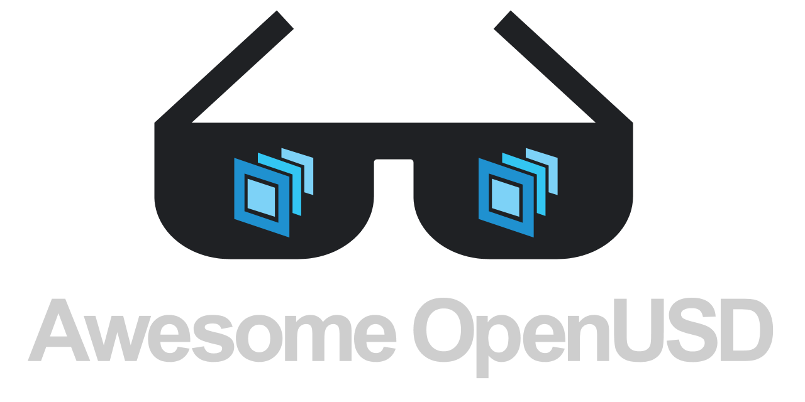

  

  

  

# Awesome OpenUSD

A curated list of awesome Universal Scene Description (OpenUSD) resources and projects. These are hand-picked resources and projects that I find awesome.

## Contents

- [Getting Started](#getting-started)
  - [Intro Videos](#intro-videos)
  - [First Steps](#first-steps)
- [Libraries & Tools](#libraries--tools)
  - [Core & Implementations](#core--implementations)
  - [Viewers & Editors](#viewers--editors)
  - [Web Viewers](#web-viewers)
  - [Pipeline & Developer Utilities](#pipeline--developer-utilities)
  - [DCC & Game Engine Integrations](#dcc--game-engine-integrations)
  - [AI & Simulation](#ai--simulation)
  - [Converters & File Format Plugins](#converters--file-format-plugins)
  - [Hydra & Render Delegates](#hydra--render-delegates)
  - [Text Editor Plugins](#text-editor-plugins)
- [Sample Assets](#sample-assets)
  - [Production Scenes](#production-scenes)
  - [Test & Conformance Assets](#test--conformance-assets)
  - [Asset Libraries](#asset-libraries)
- [Learning](#learning)
  - [Courses & Tutorials](#courses--tutorials)
  - [Code Examples](#code-examples)
  - [Talks & Presentations](#talks--presentations)
  - [Blogs, Articles & Books](#blogs-articles--books)
  - [Certification](#certification)
- [References](#references)
  - [Documentation](#documentation)
  - [Specifications](#specifications)
  - [Community](#community)

## Getting Started

### Intro Videos

- [What is USD? (A simple explanation)](https://www.youtube.com/watch?v=tRhJW2qRunA) – Artist-friendly video introduction to OpenUSD.
- [Why You Should Use OpenUSD](https://www.youtube.com/watch?v=riqp4_eZa2Y) – More than just what OpenUSD is: why does it matter?
- [A USD primer for ARTISTS](https://www.youtube.com/watch?v=SaBXE4yQetk) – Video explanation focused for artists with some overview of Maya workflows. Short and sweet.
- [What is USD: A Primer | Rob Stauffer | SIGGRAPH 2019](https://www.youtube.com/watch?v=Yp_TRVD3wjQ) – Longer video, but more complete explanation of stage composition.
- [Five Things to Know About USD](https://www.youtube.com/watch?v=vFxytzQlOEs)
- [Understand USD Fundamentals](https://developer.apple.com/videos/play/wwdc2022/10129/) – A technical introductory overview video of USD with examples.
- [NVIDIA USD Developer YouTube Series](https://www.youtube.com/playlist?list=PL3jK4xNnlCVcUP08kj6eOzvCA82U_JKiy) – Technical intro video series covering the top unique features of OpenUSD.
- [Learn OpenUSD Videos](https://www.youtube.com/playlist?list=PL3jK4xNnlCVcae9UrxpVWyFw63QCFA6JA) – A playlist of short videos teaching the foundation concepts from Learn OpenUSD.

### First Steps

- [Introduction to USD](https://openusd.org/release/intro.html) – The official OpenUSD documentation provides a brief intro and overview.
- [Learn OpenUSD](https://docs.nvidia.com/learn-openusd/latest/index.html) – Open source USD learning path with lectures and guided exercises. The first 4 modules (Foundations) are non-technical; later modules are aimed at developers. ([Github](https://github.com/NVIDIA-Omniverse/LearnOpenUSD))
- [Book of USD](https://remedy-entertainment.github.io/USDBook/) – A less technical introduction and overview of USD and its terminology by Remedy Entertainment.
- [OpenUSD in One Weekend](https://learn-usd.github.io/) – Technical learning content to learn OpenUSD in one weekend and beyond.

## Libraries & Tools

### Core & Implementations

- [OpenUSD Github Repository](https://github.com/PixarAnimationStudios/OpenUSD) – The main repository for the Universal Scene Description (USD) project.
- [usd-core](https://pypi.org/project/usd-core/) – usd-core Python package on pypi. Use the USD core Python API without having to build USD.
- [LightUSD](https://github.com/lighttransport/tinyusdz) – A full-featured, dependency-free, lightweight USD library written in C++17. Formally tinyusdz.
- [Native Rust USD library](https://github.com/mxpv/openusd) – An implementation of Universal Scene Description written in native Rust.
- [USD Rust Bindings](https://github.com/vfx-rs/usd-bind) – Rust bindings for USD.
- [SwiftUsd](https://github.com/apple/SwiftUsd) – A Swift Package for using OpenUSD in Swift.
- [typescript-usd](https://github.com/beersandrew/typescript-usd) – An AI-assisted TypeScript port of OpenUSD that includes a browser-based usdview. [Demo](https://andrew.beer/s/usdview/)

### Viewers & Editors

- [ImGui Hydra Editor](https://github.com/raph080/ImGuiHydraEditor) – A USD editor written in C++ with ImGui.
- [OpenUsdEditor](https://openusd-editor.com/) – A lightweight native editor for viewing, navigating, and authoring OpenUSD stages, powered by Hydra 2. Available for Linux, macOS, and Windows. *(closed source, beta)*
- [Relationship Viewer](https://github.com/wdas/relationship-viewer) – relview is a visualizer for relationships between OpenUSD prims and attributes.
- [USD Manager](https://github.com/dreamworksanimation/usdmanager) – Tool from DreamWorks Animation for browsing, managing, and editing USD files.
- [USD Shell Extension](https://github.com/Activision/USDShellExtension) – Tool from Activision that adds Hydra Preview, thumbnails, context menus, and metadata search to Windows Explorer.
- [usdshadeview](https://github.com/pablode/usdshadeview) – A usdview plugin for inspecting UsdShade networks.
- [UsdNodeGraph](https://github.com/1xinghuan/usdNodeGraph) – Node graph for visualizing and editing USD files. Maya and usdview embeddable.
- [usdtweak](https://github.com/cpichard/usdtweak) – USD editing tool. Kind of like usdview with editing capabilities.

### Web Viewers

- [Hugging Face USD Web Viewer](https://huggingface.co/docs/huggingface.js/en/usd-web-viewer/README) – npm package that composes USD in WebAssembly (via the native Rust openusd library) and renders with three.js. Reports UsdPhysics data and can pose joints.
- [Needle USD Viewer](https://github.com/needle-tools/usd-viewer) – Web viewer for USD, glTF, and related formats built on Autodesk's WASM USD bindings and a three.js Hydra render delegate, with WebGL and WebGPU rendering. [Demo](https://usd-viewer.needle.tools/) *(non-commercial license)*
- [ASWF USD Web View](https://github.com/usd-wg/usd-wg-webview) – Serverless browser-based OpenUSD viewer from the ASWF USD Working Group using a WebAssembly build of OpenUSD and three.js, with Gaussian splat and MaterialX support.
- [USD_WebViewer](https://github.com/Cybernaut0815/USD_WebViewer) – Web viewer and light editor running OpenUSD as WebAssembly with three.js on WebGPU/WebGL2. Embeddable as a web component and can sync with Python, C++, or curl. *(Commons Clause license)*
- [USDZ Web Viewer](https://www.usdz-viewer.net/) – View USDZ files in the browser. Builds on Autodesk's related work. [USDZ Loader Github](https://github.com/ponahoum/three-usdz-loader) [Viewer Github](https://github.com/ponahoum/usdz-web-viewer)

### Pipeline & Developer Utilities

- [Luma URI Resolver](https://github.com/LumaPictures/usd-uri-resolver) – Luma's example URI asset resolver.
- [S3 Resolver](https://github.com/westerndigitalcorporation/usd-s3-resolver) – An Amazon S3 and MySQL asset resolver.
- [usd_chunks](https://github.com/HuginStudios/usd_chunks) – Framework for procedural node networks in OpenUSD built from small Python "chunks" stored in .usda files. Runs in usdview, Houdini, Blender, or headless. *(alpha)*
- [USD Notice Framework](https://disneyanimation.com/open-source/usd-notice-framework/) – A USD plugin from WDAS with a set of software APIs for managing the flow of notifications that are emitted when authoring USD stages.
- [Usd Optimize](https://github.com/NVIDIA-Omniverse/usd-optimize) – NVIDIA library of 45+ operations for optimizing OpenUSD stages, such as mesh cleanup, decimation, and deduplication. C++ and Python.
- [UsdQt](https://github.com/LumaPictures/usd-qt) – Reusable Qt components for building custom USD tools from Luma.
- [UsdSkel Util](https://github.com/meshula/usdskelutil) – Utilities for use with the UsdSkel schema.
- [usdstubgen](https://github.com/chadrik/usdstubgen) – Generates Python stub files (.pyi) for the USD Python API for static type analysis and code completion.

### DCC & Game Engine Integrations

You can find the latest [products using OpenUSD on openusd.org](https://openusd.org/release/usd_products.html).

- [Multiverse](https://j-cube.jp/solutions/multiverse/) – Non-destructive import/editing of USD for Maya and other DCCs.
- [Unity USD Toolkit](https://github.com/Unity-Technologies/com.unity.usd-toolkit) – Unity package for reading and writing OpenUSD stages at runtime and in the Editor. *(experimental)*

### AI & Simulation

- [BowerBot](https://github.com/binary-core-llc/bowerbot) – Open-source AI agent that assembles production-correct OpenUSD scenes from natural language. ASWF-compliant hierarchy, MaterialX materials, lighting, and validation. [Demo](https://youtu.be/dXYdiJi2lXU)
- [Robot Reel](https://github.com/noteflowai/robot-reel) – Exports recorded Newton, Genesis and digital-twin simulations to animated OpenUSD, and reads every time sample back against the source data. [Demo](https://noteflowai.github.io/robot-reel/cloth/)

### Converters & File Format Plugins

- [Adobe USD File Format Plugins](https://github.com/adobe/USD-Fileformat-plugins) – A collection of file format plugins for FBX, glTF, OBJ, PLY, SBSAR, SPZ, and STL.
- [fspy-USD](https://github.com/Vochsel/fspy-USD) – Converts fSpy camera matching file to USD.
- [gltf2usd](https://github.com/kcoley/gltf2usd) – glTF to USD converter with ARKit/USDZ support.
- [guc](https://github.com/pablode/guc) – glTF to USD converter that boasts near-lossless material translation via MaterialX.
- [Omniverse Asset Converter](https://docs.omniverse.nvidia.com/extensions/latest/ext_asset-converter.html) – Python API and microservice for converting FBX/glTF/OBJ to USD.
- [ptc2usd](https://github.com/simpassi/ptc2usd) – Converts Pixar's PTC and Houdini JSON point clouds to USD.
- [USD Exchange SDK](https://github.com/NVIDIA-Omniverse/usd-exchange) – Accelerates OpenUSD adoption by helping developers design, build, and test their own USD I/O solutions.
- [usdat](https://github.com/dreamworksanimation/dwa_usd_plugins/tree/master/pxr/usd/plugin/usdat) – A FileFormat plugin from DreamWorks Animation that enables working with templating in USD files.
- [mujoco-usd-converter](https://github.com/newton-physics/mujoco-usd-converter) – A MuJoCo to OpenUSD data converter.

### Hydra & Render Delegates

- [3Delight|NSI](https://gitlab.com/3Delight/HydraNSI) – Hydra render delegate for 3Delight resp. any renderer implementing the NSI API.
- [Arnold USD](https://github.com/Autodesk/arnold-usd) – Arnold Hydra render delegate and schemas.
- [gatling](https://github.com/pablode/gatling) – Hydra render delegate for GPU-based path tracer.
- [HdAurora](https://github.com/Autodesk/Aurora/blob/main/Doc/HdAurora.md) – Hydra render delegate for Autodesk's real-time GPU pathtracing renderer.
- [Hydra Viewport Toolbox](https://github.com/Autodesk/hydra-viewport-toolbox) – Utilities to support graphics viewports using OpenUSD Hydra.
- [LuxCoreRender](https://github.com/jbgann/LuxCoreRenderUSD) – LuxCoreRender Hydra render delegate.
- [Moonray](https://github.com/dreamworksanimation/hdMoonray) – Hydra render delegate for DreamWorks Animation's Moonray.
- [Radeon ProRender](https://github.com/GPUOpen-LibrariesAndSDKs/RadeonProRenderUSD) – Hydra render delegate for AMD's Radeon ProRender.

### Text Editor Plugins

- [Notepad++ Syntax Highlighter](https://github.com/AndrewHazelden/PIXAR-USD-Syntax-Highlighter) – USDA file syntax highlighting in Notepad++.
- [usd-idea](https://github.com/justint/usd-idea) – PyCharm plugin adding syntax highlighting, reference linking, brace matching/folding, etc.
- [usda-syntax](https://github.com/superfunc/usda-syntax) – Syntax highlighting for USDA files in vim, emacs & sublime.
- [VS Code USD Language Extension](https://marketplace.visualstudio.com/items?itemName=AnimalLogic.vscode-usda-syntax) – From Animal Logic, adds syntax highlighting and reference linking.

## Sample Assets

Scene and other assets put together to test USD features and as examples of how to compose your assets and stages.

### Production Scenes

- [Animal Logic](https://dpel.aswf.io/alab/) – USD ALab.
- [Blender Sample Assets](https://download.blender.org/institute/sybren/usd/)
- [Disney Moana Island Scene](https://www.disneyanimation.com/resources/moana-island-scene/) – Full island scene data from Moana animated feature film.
- [Intel Sample Assets](https://www.intel.com/content/www/us/en/developer/topic-technology/graphics-research/samples.html) – Provided under ASWF license by Intel.
- [J Cube Sample Assets](https://j-cube.jp/solutions/multiverse/assets/) – USD Esper Room scene and USDZ Maneki asset.
- [Pixar Sample Assets](https://openusd.org/release/dl_downloads.html#assets) – Kitchen Set, City Set, UsdSkel Examples.
- [SideFX Sample Assets](https://www.sidefx.com/contentlibrary/) – Mexican Still Life, Elephant Seal, Bar Scene, Market Scene.

### Test & Conformance Assets

- [ASWF USD WG Assets](https://github.com/usd-wg/assets) – Test assets and asset guidelines from the ASWF USD Working Group.
- [McUsd Sample Assets](https://github.com/erich666/McUsd) – Simple geometry with a variety of UsdPreviewSurface materials for material and light testing.
- [USD Museum](https://github.com/beersandrew/usd-museum) – CC0 OpenUSD scene that demonstrates USD features one exhibit at a time, with reference marks to check whether a viewer or runtime renders each feature correctly.

### Asset Libraries

- [Apple Sample Assets](https://developer.apple.com/augmented-reality/quick-look/) – Quick Look sample USDZ.
- [Lowe's Open Builder](https://www.lowesopenbuilder.com/) – Over 500 furniture models from the Lowe's catalog in USDZ format.
- [SimReady Central](https://huggingface.co/spaces/nvidia/simready-central) – SimReady 3D assets with USD and RTX simulation previews.
- [SimReady Materials](https://github.com/NVIDIA-Omniverse/PhysicalAI-SimReady-Materials) – 1,700+ physically based materials from NVIDIA as UsdShade with MaterialX OpenPBR shader graphs. MIT-0 licensed.

## Learning

See also [First Steps](#first-steps) for beginner-friendly learning paths.

### Courses & Tutorials

- [Pixar USD Tutorials](https://openusd.org/release/tut_usd_tutorials.html) – 14 modules with step-by-step instructions showing how to use the Python API and the results in USDA and usdview.
- [Primventure](https://github.com/aivxx/primventure) – A gamified companion to Learn OpenUSD: a local dungeon crawl where you clear rooms by writing real Python against usd-core.
- [USD Survival Guide](https://lucascheller.github.io/VFX-UsdSurvivalGuide/introduction/overview.html) – An onboarding guide for software engineers and pipeline TDs with practical and production examples.
- [OmniverseUSD Guide](https://omniverseusd.github.io/) – A from-the-ground-up introduction to OpenUSD through Omniverse Python runnable examples.

### Code Examples

- [Colin Kennedy's USD Cookbook](https://github.com/ColinKennedy/USD-Cookbook) – Basic to advanced examples of USD in C++, Python, and USDA formats.
- [NVIDIA OpenUSD Code Samples](https://docs.omniverse.nvidia.com/dev-guide/latest/programmer_ref/usd.html) – Index of task-focused OpenUSD snippets.
- [Tiny USD program](https://github.com/meshula/tinyusd) – A really small getting-started program for USD on Windows.
- [usd-core on Google Colab](https://github.com/philsawicki/usd-core-on-google-colab) – Example showing how you can use usd-core on Google Colab notebooks.
- [USD Imaging on Google Colab](https://github.com/philsawicki/usd-imaging-on-google-colab) – Example showing how you can use USD Imaging on Google Colab notebooks.
- [USD Plugin Examples](https://github.com/wetadigital/USDPluginExamples) – Simple examples to demonstrate how to compile and build USD plugins.

### Talks & Presentations

- [ASWF USD-WG Presentations](https://wiki.aswf.io/display/WGUSD/Presentations) – Interesting presentations from the ASWF USD Working Group.
- [Typhoon: A Reference Renderer for OpenUSD Interoperability](https://hosted-files.sched.co/osd2026/20/A%20Reference%20Renderer%20for%20OpenUSD%20Interoperability%20-%20Anders_Langlands.pdf) – Open Source Days 2026 slides from NVIDIA proposing Typhoon, a CPU path tracer extending hdEmbree with full MaterialX/OpenPBR and UsdLux support.
- [USD at Remedy Entertainment](https://www.youtube.com/watch?v=FI2pyzTOvaQ) – Presentation about how Remedy Entertainment uses USD for gamedev.
- [USD in Production](https://dl.acm.org/doi/10.1145/3587423.3595531) – SIGGRAPH 2023 Course.

### Blogs, Articles & Books

- [Confusing Acronym Blog](https://confusing-acronym.com) – A blog about OpenUSD with a lot of technical explanations.
- [Inter-Process Communication In Real-Time 3D Applications](https://a.co/d/0e3Z5Znj) – A hands-on guide to building a real-time LiveLink pipeline — streaming OpenUSD data from Autodesk Maya to a custom viewer using gRPC.
- [OpenUSD in Three.js: A Houdini Solaris Test of USD Web Viewer](https://digitalgarden.si/blog/openusd-threejs-usd-web-viewer/) – Hands-on test of bringing a Houdini Solaris USD scene into a three.js web viewer, by Alicia.

### Certification

- [OpenUSD Development Certification](https://www.nvidia.com/en-us/learn/certification/openusd-development-professional/) – An intermediate-level credential that validates a candidate’s ability to build, maintain, and optimize 3D content creation pipelines using OpenUSD.
- [Why Get Certified](https://docs.nvidia.com/learn-openusd/latest/why-openusd-developer-certification.html) – What is the OpenUSD Development Certification and why it's important.
- [OpenUSD Foundations and Workflows Certification Series](https://matiascodesal.com/series/openusd-foundations-and-workflows-certification/) – A no-code blog series by Matias Codesal for workflow specialists preparing for the OpenUSD Foundations and Workflows certification.

## References

### Documentation

- [OpenUSD Documentation](https://openusd.org/release/index.html) – The official OpenUSD documentation.
- [USD C++ API Documentation](https://openusd.org/release/api/index.html) – The primary USD C++ API documentation.
- [USD Python API Documentation](https://docs.omniverse.nvidia.com/kit/docs/pxr-usd-api/latest/pxr.html) – OpenUSD Python API documentation from NVIDIA.
- [NVIDIA OpenUSD Documentation](https://docs.omniverse.nvidia.com/usd/latest/index.html) – Supplemental OpenUSD documentation from NVIDIA.
- [NVIDIA's Python API Notes](https://docs.omniverse.nvidia.com/usd/latest/technical_reference/api-comparison.html) – A primer for USD Python API usage.

### Specifications

- [AOUSD Specifications](https://github.com/aousd/specifications-public) – Normative OpenUSD specifications from the Alliance for OpenUSD, including the USD Core Specification, in PDF and Markdown.
- [AOUSD Core Spec Supplemental](https://github.com/aousd/core-spec-supplemental-public) – Reference sample implementations and a compliance-testing framework for the USD Core Specification, released as Python packages matched to each spec version.
- [OpenPBR](https://academysoftwarefoundation.github.io/OpenPBR/) – ASWF specification for a standard physically based über-shader, synthesized from Autodesk Standard Surface and Adobe Standard Material, with a reference implementation in MaterialX.

### Community

- [AOUSD Forum](https://forum.aousd.org/) – The main place to ask questions and get help with OpenUSD.
- [usd-interest Google Group](https://groups.google.com/g/usd-interest) – Search through years of archived USD questions.
- [ASWF USD Working Group](https://github.com/AcademySoftwareFoundation/wg-usd) – Information about the ASWF USD Working Group.